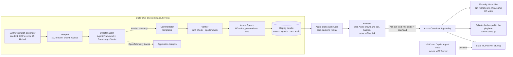

# Audio Stands

**A seat in the stands for football fans who can't see the pitch.** A reactive crowd, a ball you can hear move, a
heartbeat on your phone, and an AI commentator whose voice builds *before* the big chance, because the pipeline already
knows it's coming. And you can ask that commentator, out loud, "where's the ball?" at any moment.

[](https://github.com/nikikrustev/BerbataAI/actions/workflows/uptime.yml)
[](https://github.com/nikikrustev/BerbataAI/actions/workflows/ci.yml)


**Category: Best Use of Microsoft Foundry.** Team Berbata AI, for the Inside the Game hackathon (Microsoft × Premier League).

- **Live demo (no login, no backend needed for the match):** https://lively-ocean-0efe4ae0f.2.azurestaticapps.net/
- **Demo video (1:52):** _link added at submission (Stage 9b)_
- **Synthetic match, real pipeline.** Fictional clubs (Reds and Navy), fictional players, AI voices. No real match data.

## Judges' quick path (60 s)

1. Open the [demo](https://lively-ocean-0efe4ae0f.2.azurestaticapps.net/?radar=1) with **headphones** (laptop speakers work too).
   `?radar=1` adds a sound radar so you can see what you hear.
2. Press **Start** (or Enter). The first line is "AI commentary, synthetic match." **Five seconds later the voice builds:
   "Navy coming... Olvholm... here's a chance!"**, four seconds before the header, while the crowd rises with it.
3. Press **A** and pick **Where's the ball?**: an answer in the same voice, then the match carries on. **Ask out loud**
   (microphone) asks the commentator anything through Foundry Voice Live. Try "Who wins?": it won't tell you.
4. Press **Next big moment** to jump to the next chance, and open **Settings** for your end of the ground, crowd level and vibration.

On an Android phone in Chrome you also feel the match: a heartbeat that follows the tension, and a pattern for each shot and goal.

## The problem

- In RNIB's 2022 research with blind and partially sighted fans, ordinary TV football commentary scored **6.1 out of 15**
  for enjoyment, access and being able to follow the game. Fans want one voice that says where the ball is, in real time.
- **Lag** is their biggest technical complaint: the crowd roars before the description says why.
- Today's options (club headsets, radio, TV audio description) are one-way and the same for everyone. Nobody lets the fan
  ask "where is it?", or set the crowd against the voice.

Sources and more: [`stoynev research/36-blind-fans-and-audio-description.md`](stoynev%20research/36-blind-fans-and-audio-description.md).

**Our answer:** generate the crowd, the ball sound, the vibration and the commentary **from the same event stream**, so
they can't drift apart, and use the pipeline's look-ahead to build tension without ever giving the result away. No public
hackathon entry or product we found combines a look-ahead commentator, a reactive crowd, haptics and a voice you can question
([file 42](stoynev%20research/42-audio-competitors-and-demo.md)).

## How it works: Ingest → Interpret → Explain → Render → Personalise

| Stage | What happens | Where | Tech |
|---|---|---|---|
| **Ingest** | A seeded match generator plays a whole synthetic match: CDF v0.3.2 events, the ball at 25 Hz and all 22 players at 5 Hz. The judge cut is 8 minutes of the second half (56:10–64:10, seed 24): a goal with a VAR check, a save, a block, a yellow card. | `pipeline/audiostands/generator.py`, `movement.py`, `judge_cut.py`, `build_match.py` | Python, numpy |
| **Interpret** | Per second: win probability, suspense, tension, danger, and the crowd's mood at each end. Per event: xG, priority, zone, and the words a commentator may say before and after the outcome. | `interpret.py`, `crowd.py`, `haptics.py` | Python |
| **Explain** | The **Director** agent sees the next 10 s and returns only a tension plan. The **Commentator** turns facts plus that plan into lines; the **Verifier** checks every number against the truth and every word for spoilers. | `agents/`, `commentary/` | **Microsoft Agent Framework**, **Foundry** (gpt-5-mini), Application Insights |
| **Render** | Each line is pre-rendered in an **Azure Speech HD voice** (Brian). In the browser, Web Audio plays a crowd per end, a ball rattle panned left to right, sound icons for passes, shots and whistles, and ducks the crowd under the voice. Captions (SDH) and descriptions ship as WebVTT. | `commentary/tts.py`, `web/src/audio/`, `web/src/lane-a/commentary-track.ts` | **Azure Speech**, **Azure Static Web Apps** |
| **Personalise** | Pick your end (Reds or Navy), crowd level, vibration (off, key moments, or heartbeat too), Bluetooth delay calibration, a 2-minute "learn the sounds" tour. **Ask**: four offline presets, or a spoken question answered live; "turn the crowd down" works by voice too. | `web/src/settings.ts`, `web/src/ask/`, `web/src/lane-a/live-ask.ts`, `relay/` | **Foundry Voice Live**, **Azure Container Apps** |

## Architecture (what shipped)



- **The match needs no backend.** Everything a judge hears in the replay is a static file on Static Web Apps (Free).
- **The relay scales to zero** to stay free during judging. The page wakes it on load; if it is still cold when you
  press Ask, you hear "Live questions aren't available right now" and get the presets. Caps: 30 questions a session,
  200 a day, 6 sessions per 10 minutes per IP ([`relay/README.md`](relay/README.md)).
- **Keyless.** The build uses `az login`; the relay uses a managed identity. CI needs no Azure credentials.
- Infrastructure is Bicep, deployed with `azd` ([`infra/`](infra/), [`azure.yaml`](azure.yaml)). Decisions and what we
  measured along the way are in [`docs/DECISIONS.md`](docs/DECISIONS.md).

## Agents and MCP

**The spoiler firewall.** A live broadcast is delayed by a few seconds. We use a 10 s look-ahead to make the commentary
better, and build the agents so that it can't leak:

| Agent | Sees | Outputs | Runs on |
|---|---|---|---|
| **Director** | The next 10 s, through an allow-list: event types, zones, xG, seconds to the shot, score, tension. Never the outcome, the shot's end point, VAR, or any outcome text. A test rewrites each shot's ending and checks the Director's input is byte-identical. | A tension plan only: `build_up_level`, `lead_s`, `hold_ms`, `hint_type` (JSON schema, strict) | Agent Framework `Agent` on Foundry `gpt-5-mini`, traced to Application Insights. One call per shot, ~490 tokens. |
| **Commentator** | Facts up to now, plus the plan | The spoken lines, from templates | Code (the LLM stays off the hot path) |
| **Verifier** | Every line and every plan | Pass, or a fallback: any failure (timeout, quota, bad JSON, a failed check) drops that window to the rules Director, which is the MVP's output byte for byte | Code |
| **Q&A (live)** | Only the playhead the fan pressed at, injected by the relay. The model never sets the clock. | Spoken answers in the commentary voice, 1–2 sentences, no predictions, no betting | Foundry Voice Live (`gpt-realtime-2.1-mini`), tools from `audiostands.qa` |

**The 8 Q&A tools** (`pipeline/audiostands/qa/`): `get_score_and_clock`, `get_ball_position`, `where_is`,
`get_player_stats`, `get_last_events`, `explain_moment`, `what_did_i_miss`, `set_preferences`. Each is clamped to the
playhead; a property test checks 200 random playheads for evidence from the future. The same tools power the offline
presets (a keyword router, no LLM), the live voice (Voice Live function calls) and the **Stats MCP server** (MCP SDK,
streamable HTTP, mounted at `/mcp` on the relay; `.vscode/mcp.json` lists it next to the Azure MCP Server).

If you ask during a build-up, the commentator says "Hold that thought, watch this!": it tells you *that* something is
coming, never *what*.

## Results (measured)

From [`eval/report.json`](eval/report.json), rendered in [`eval/report.md`](eval/report.md) by `eval/build_report.py`.
Judge cut, voice `en-US-Brian:DragonHDLatestNeural`, Director `gpt-5-mini`, measured 23 Oct 2026.

| Measure | Value | Notes |
|---|---|---|
| Spoiler leaks in the commentary | **0** of 70 lines | An outcome word before its reveal counts as a leak |
| Lines passing the truth check | **70/70** | |
| Spoken numbers verified | **10/10** | scores and clock |
| Director: calls, model plans, fallbacks | 4 calls, 4 plans, **0 fallbacks** | 488 tokens per call |
| Real-time budget: plan → verify → TTS per build-up | **10/10** within budget, p50 2.98 s, p95 3.56 s | budget 5.8–6.0 s; idle time between shots shortened ÷10, every step at real speed |
| Numeric truth as a Foundry custom evaluator | **4/4** passed | code-based evaluator (preview) on Foundry |
| Live spoken questions (Voice Live) | **31/31** answered, **0** spoiler hits | B's 31 eval questions, spoken by a TTS "fan" |
| Live latency: end of question → first answer audio | **p50 1.14 s**, p95 1.82 s | to the first audio after the tool results: p50 2.66 s, p95 3.35 s |
| Offline Q&A router | 31/31 correct, 0 leaks | answer 18/18, clarify 4/4, redirect 2/2, refuse 7/7 |
| Accessibility CI | axe, WCAG 2.0/2.1/2.2 A and AA tags, 3 viewports, with and without reduced motion, light and dark | must pass with zero violations ([CI](https://github.com/nikikrustev/BerbataAI/actions/workflows/ci.yml)) |
| Eyes-closed listening test | **TODO: not run yet** | Protocol: [`eval/listening_test.md`](eval/listening_test.md). Results go here and in `eval/report.md` once `eval/listening_test.csv` is filled in; no numbers until then. |

**Honest limits.**
- **Spoiler lift is not meaningful yet:** P(goal | build-up) = 0.5 against mean xG 0.15, but n = 2. It needs many seeds.
- **21 of 70 lines (30%) use a shorter fallback text** so they fit the gap before the next moment (18 of them are ball-position lines).
- **The match generator misses two realism targets** (`out/realism_report.md`, rebuilt by `build_match`, generator over seeds 1–50):

  | Metric | Ours | Target | Verdict |
  |---|---|---|---|
  | Shot conversion | 10.1% | 11–11.9% | 🔴 red |
  | Pass completion | 85.2% | ~84% (unverified target) | 🔴 red |
  | Goals, passes, shots per match; distance, top speed, time below 6 km/h | inside the target | | 🟢 green (6 rows) |

  The targets are published league averages ([file 02](stoynev%20research/02-synthetic-match-data.md),
  [file 19](stoynev%20research/19-realistic-player-movement.md)); they only set the ranges we check against, and no real
  match data goes into the generator.
- **One detail level ships: Radio** (the ball and key moments). Describer and Calm were cut ([D18](docs/DECISIONS.md)).
- **Not yet tested with blind users.** Audio Stands is designed from published research with blind and partially sighted
  football fans (RNIB 2022–23, Level Playing Field, UEFA/CAFE guidance). Our next step is testing with blind fans.

## Synthetic data

- Every event, position and player comes from `pipeline/audiostands/generator.py` (v0.2.0) with a fixed seed. The judge cut
  is seed 24, second half, 670–1150 s (56:10–64:10), at the fictional ground Emberfield. `meta.json` says
  `"synthetic": true`.
- No real match data, footage, clubs, players, commentators, logos or music. We use no StatsBomb data, and no xT or EPV
  grid fitted on real matches (`CLAUDE.md`).
- Rebuilds are deterministic: the match files come out byte-identical on every run (a test checks the sha256), and
  `python -m audiostands.build_bundle --cut judge` replays the recorded Director plans and cached voice with no Azure calls.

## Run it yourself

```bash
# The replay, no keys (http://localhost:5173)
cd web && npm ci && npm run dev
```

```bash
# Tests, no keys: Python (pipeline + relay), then TypeScript and the axe tests
pip install -e "pipeline[dev]" -r relay/requirements-test.txt && (cd pipeline && pytest) && (cd relay && pytest)
cd web && npm ci && npm test && npx playwright install chromium && npm run test:a11y
```

Rebuilding the voice, the Director or the relay needs our Azure resources: see `pipeline/requirements-azure.txt`,
[`relay/README.md`](relay/README.md) and [`scripts/bootstrap_azure.sh`](scripts/bootstrap_azure.sh).

**Repo map:** `pipeline/` (match, signals, commentary, agents, Q&A brain, evals) · `web/` (the player) · `relay/`
(live Ask and MCP) · `infra/` (Bicep) · `contracts/` (the match format and golden test cases) · `eval/` (results) ·
`video/` (the demo video's script, shot list and captions) · `stoynev research/` (our research library).

## Licences

- **Crowd sounds:** 16 clips cut from Freesound recordings, all **CC0-1.0**, each listed with author, source URL and the
  cut used in [`assets/licences.json`](assets/licences.json).
- **Voices:** Azure AI Speech neural HD voices (`en-US-Brian`), used under our Azure subscription, and labelled as AI in
  the app ("AI commentary, synthetic match.") and the video.
- **Dependencies** (versions pinned in the lockfiles):

  | Package | Licence | Where |
  |---|---|---|
  | numpy | BSD-3-Clause | pipeline |
  | mcp (MCP Python SDK), common-data-format-validator | MIT | pipeline (dev, MCP server) |
  | fastapi | MIT | relay |
  | httpx | BSD-3-Clause | relay tests |
  | uvicorn | BSD-3-Clause (unverified) | relay |
  | azure-identity | MIT | build, relay |
  | azure-cognitiveservices-speech | Microsoft's own licence (not open source) | build only |
  | openai | Apache-2.0 | build only |
  | agent-framework-core, agent-framework-foundry, azure-ai-projects, azure-monitor-opentelemetry, azure-ai-voicelive | MIT (unverified) | build, relay |
  | vite, vitest | MIT | web (dev) |
  | typescript, @playwright/test | Apache-2.0 | web (dev) |
  | @axe-core/playwright | MPL-2.0 | web (dev, tests only) |

  No GPL code, model or build tool: we avoided Ultralytics YOLO and the GPL calibration tools (`CLAUDE.md`).
  "(unverified)" means we have not checked it against the installed package's metadata.

## How we built it

**Who built what.**
- **Nikolay** built the match and its signals (Stage 1), the browser sound stage (Stage 2), haptics, settings and the UI,
  the Q&A brain (the 8 playhead-clamped tools, the no-LLM router, the persona, catch-up and "hold that thought"), the Stats
  MCP server, the Q&A eval, the sound radar, "learn the sounds" and Bluetooth calibration.
- **potencialbg** built the Microsoft side: Azure set-up and infrastructure, the look-ahead commentary and its verifier,
  the HD voice, the Director agent on Foundry with tracing and the evals, the relay with Foundry Voice Live, CI and the
  deploys. On 24 Oct Nikolay handed over his lane, and potencialbg finished his Stage 8–9 items: the Playwright + axe
  accessibility tests, the listening-test kit, and this write-up and the video.

**Tools.**

| Tool | What it actually did | Evidence |
|---|---|---|
| **Claude Code** (Anthropic) | The research library, then each build stage: both of us worked stage by stage from the prompts in [`PROMPTS.md`](PROMPTS.md), and reviewed, tested and merged the result ourselves. | [`PROMPTS.md`](PROMPTS.md), `Co-Authored-By: Claude` commit trailers |
| **GitHub Copilot Agent Mode** + **Azure MCP Server** | Read-only checks of the deployed Azure resources from VS Code (Copilot Free, `@azure/mcp` 3.0.0, `--read-only`). It wrote none of our code. | [`docs/DECISIONS.md` D14](docs/DECISIONS.md), [`.vscode/mcp.json`](.vscode/mcp.json) |
| **Azure Developer CLI + Bicep** | Provisioning and deploys | [`infra/`](infra/), [`azure.yaml`](azure.yaml) |
| **GitHub Actions** | CI (pytest, vitest, Playwright + axe) with no Azure credentials, and the uptime check every 6 h | [`.github/workflows/`](.github/workflows/) |

**AI-assist ledger** (git trailers on `main` up to `09acc63`, 24 Oct 2026):

| | Commits |
|---|---|
| Non-merge commits | 87 |
| with a `Co-Authored-By: Claude` trailer | 62 (mostly the research library) |
| with a Copilot trailer or `ai:copilot` label | 0 |

The trailers undercount Claude Code: our squash merges kept only the PR title and summary, so most stage PRs carry no
trailer even though they came from Claude Code sessions. Recount with
`git log --no-merges -i --grep="Co-Authored-By: Claude" --oneline | wc -l`.

## What's next

- **Test with blind and partially sighted fans**, paid and one to one, repeating RNIB's two-clip design.
- The **Describer** and **Calm** detail levels (D18).
- A **live** path instead of the replay: Event Hubs → a Container Apps worker → Web PubSub.
- Personalisation that follows you between devices (Cosmos DB); settings live in the browser today.
- Bulgarian commentary; game-controller rumble; a "point your phone to listen" mode; native iPhone haptics (AHAP).

## Team

**Berbata AI** (Innovation Studio entry 126726):
- **Nikolay Krastev** ([@nikikrustev](https://github.com/nikikrustev)): match, sound stage, haptics, Q&A brain, MCP server.
- **potencialbg** ([@potencialbg](https://github.com/potencialbg)): the Microsoft side, the deploys, and the finish.
