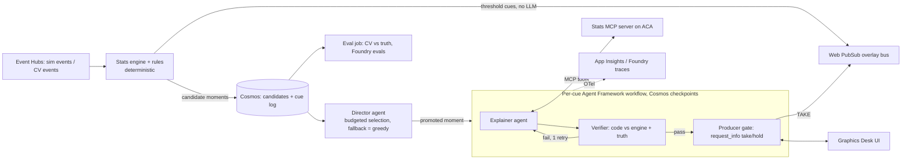

# 18 — Scoring on "Agentic Design" without becoming another agent crew

_Accessed/compiled: 20 Oct 2026 · Priority area: Agentic Design & Innovation (20%), the Interpret → Explain → Render control plane, and category fit (Multi-Agent / Foundry / Cloud Native)_

## TL;DR

- **The rules reward how agents are used, not how many there are.** The Agentic Design criterion asks three things: how creatively agentic patterns are applied; whether there is "sophisticated agent orchestration, MCP integration, or multi-agent collaboration"; and whether the AI is "novel" or "meaningfully improve[s] upon existing approaches". About 40-50 rival entries ship the same studio crew of LLM personas plus an LLM fact-checker, so that pattern is now table stakes. It will not score as innovative.
- **Our angle: agents make the decisions, code keeps the facts, and the LLM stays off the hot path.** Four parts sit beside the deterministic pipeline:
  - a **Director** agent that decides *which* moments go to air under a screen-time budget;
  - an **Explainer** agent that pulls numbers from our stats engine through **MCP tools** instead of being handed a blob;
  - a **Verifier** that is plain code, checking every number against the engine and the simulator's ground truth;
  - a **producer take/hold** step built on Agent Framework human-in-the-loop, with Cosmos DB checkpoints so a pending decision survives a crash.
- **Everything needed is GA or documented today.** Agent Framework Python (`agent-framework` 1.22.0, released 15 Oct 2026) provides graph workflows, `ctx.request_info()` + `@response_handler` for human approval, `CosmosCheckpointStorage`, and OpenTelemetry spans per executor. The MCP Python SDK is at v2.3.0. **In v2, `FastMCP` was renamed `MCPServer`**, and old `mcp.server.fastmcp` imports now fail.
- **Observability and evaluation are scoring points, not extras.** We get a single trace from the workflow, through the agent and the model call, into our MCP server (Agent Framework propagates `traceparent` to client-opened MCP tools). On top of that we run Foundry evaluations: a **code-based custom evaluator** for numeric truth, plus the built-in Groundedness and Tool Call Accuracy evaluators. Together they back the claim that our agents are measurably right, which most crews cannot show.
- **Stay in Best Azure Cloud Native Integration (per research 12) and let this layer win the 20% Agentic score.** The design also meets the Multi-Agent category's own test (distinct roles, shared state, handoffs, failure recovery) if the judges reassign us.

## Findings

### 1. What the official repo says (and does not say)

The repo `microsoft/insidethegamehackathon` contains exactly five files. There is **no README, starter code, sample data or SDK template**.

| File | Content |
|---|---|
| `OFFICIAL RULES.md` | Rules, categories, judging criteria |
| `RESOURCE PLAYLISTS.md` | Links to AI Skills Navigator playlists: GitHub Copilot, Azure AI Foundry, Foundry Agents, **Agentic Workflows**, Data |
| `CODE OF CONDUCT.md`, `LICENSE.md`, `SECURITY.md` | Boilerplate |

Rule wording that matters for this topic:

- **Agentic Design & Innovation (20%):** "How creatively does the solution apply Agentic AI patterns?" / "Does the Project demonstrate sophisticated agent orchestration, MCP integration, or multi-agent collaboration?" / "Is the AI implementation novel, or does it meaningfully improve upon existing approaches?"
- **Technological Implementation** names the "hero technologies": Microsoft Foundry, Agent Framework, **Azure MCP**, **GitHub Copilot Agent Mode**, Fabric, GitHub SDK/CLI, Azure Apps and AI Services, and Azure databases.
- **Best Multi-Agent System:** judges check whether "specialized agents have distinct roles, coordinate through shared state and effective handoffs, recover from failures, and deliver an end-to-end outcome a single agent could not achieve as effectively".
- **Best Use of Foundry:** "development, orchestration, and management of AI-powered solutions".
- **Best Azure Cloud Native:** "event-driven architectures, automation, operational excellence".

**Reading:** "orchestration", "MCP" and "failure recovery" are named outright. "Number of agents" is not mentioned anywhere.

### 2. Table stakes vs innovative (given 40-50 crew entries)

| Table stakes (everyone has it) | What reads as innovative / "meaningfully better" |
|---|---|
| Commentator, analyst and stats personas chatting together | An agent making a **constrained decision** (what airs, when, and for which audience) with a measurable outcome |
| An LLM "fact-checker" checking another LLM | A **code verifier against ground truth**. Our simulator gives us the truth, so we can measure on-air accuracy. |
| Stats pasted into the prompt | **Tools/MCP**: the agent asks for exactly the numbers it needs, and every call is logged as evidence |
| Overlay JSON, analyst and casual modes | **Human-in-the-loop take/hold** that matches real broadcast practice, plus checkpoint/resume |
| "We use Agent Framework" | A **trace and eval dashboard** with latency, cost and accuracy per agent, and **deterministic fallbacks** when the LLM fails |

The neutral references back this framing:

- **Anthropic** separates *workflows* (LLMs orchestrated through predefined code paths) from *agents* (LLMs directing their own tool use). It advises the simplest solution that works, and agents only where steps can't be hardcoded. It names evaluator-optimizer and orchestrator-workers as patterns.
- **OpenAI's guide** says agents fit "complex decision-making" and "unstructured data", and that "a deterministic solution may suffice" otherwise. It recommends maximising a single agent before adding more, and escalating to a human on "exceeding failure thresholds" and "high-risk actions".
- **Agent Framework's own docs** (quoted in research 03): "If you can write a function to handle the task, do that instead of using an AI agent."

Choosing which moment to air, out of many candidates under a budget, is the one genuinely judgment-shaped task in our pipeline. That is where the agent belongs.

### 3. Agent Framework building blocks we would use (Python)

| Need | API (verified in docs) |
|---|---|
| Graph of steps | `WorkflowBuilder(start_executor=..., checkpoint_storage=...)`, `.add_edge(a, b, condition=...)`, `.add_switch_case_edge_group(...)`, `.add_fan_out_edges` / `.add_fan_in_edges` |
| Steps | `class X(Executor)` with `@handler`, or the function decorator `@executor(id=...)`. Use `ctx.send_message()` to pass a message on and `ctx.yield_output()` to return a result. An `Agent` can itself be an executor. |
| Human approval | `await ctx.request_info(request_data=..., response_type=...)` plus a `@response_handler` method. The caller sees an event with `type == "request_info"` and resumes with `workflow.run(stream=True, responses={request_id: value})`. |
| Durability | `InMemoryCheckpointStorage`, `FileCheckpointStorage`, or `CosmosCheckpointStorage` (`agent-framework-azure-cosmos`). Checkpoints are written at each superstep end and **include pending requests**. On restore, those requests are re-emitted. You can pass `checkpoint_id` and `responses` together in one call. |
| Tool approval inside agents | `@tool(approval_mode="always_require")` causes a `function_approval_request` |
| Orchestrations | Sequential, Concurrent, Handoff, Group Chat, Magentic. **We do not need these for the live path.** |

Two gotchas from the docs:

- **Supersteps have a barrier.** A slow LLM executor blocks every other branch in the same superstep. That is one more reason to keep overlays that must render fast out of the workflow entirely.
- **Runs are stateful.** "Runs are not isolated; state is preserved across multiple calls to run". Build **one short-lived workflow per cue** from a factory function rather than sharing one instance across cues.

### 4. Tools and MCP: three ways to expose the stats engine

| Option | When | Notes |
|---|---|---|
| Local Python functions as tools (`@tool`) | Fastest path, same process | No network hop. Not reusable outside our app. |
| **Our own MCP server** (MCP Python SDK `MCPServer`, streamable HTTP on ACA), consumed by Agent Framework through `MCPStreamableHTTPTool` | **Recommended.** It visibly earns the "MCP integration" credit, and Copilot, Foundry agents or any MCP client can reuse it. | The SDK traces every `tools/call` as a span named `tools/call <tool>`, using the GenAI conventions. Agent Framework injects `traceparent` into `params._meta`, but only for MCP sessions it opens itself, not for hosted MCP tools. |
| Foundry Agent Service MCP tool or **Toolbox** (one managed MCP endpoint; adds governance and tool search) | If we also want a server-side Foundry prompt agent | Remote endpoints only. **`require_approval` defaults to `always`**, so set it to `never` for our read-only tools. Non-streaming MCP calls time out after **100 s**. Private endpoints need Standard setup plus a VNet. |

Other Foundry facts:

- **The classic "Connected Agents" tool is not available in the new Foundry Agent Service.** The docs point to Foundry **workflows** or the **A2A tool** instead.
- The **A2A tool is GA** (protocol 1.0, JSON-RPC). Foundry agent targets support text only, with no streaming. That makes A2A an optional extra for us, not core.
- **Azure MCP Server** (a hero technology) exposes `monitor`, `cosmos`, `eventhubs`, `foundry`, `applicationinsights` and other namespaces. It supports `--read-only` and `--namespace` flags.
  - The docs say the local server is "intended strictly for developer use".
  - Use it honestly: in **GitHub Copilot agent mode** during development, for example "query Log Analytics for Explainer p95". A self-hosted remote deployment for Foundry also exists.

### 5. Observability and evals that judges can see

**Tracing setup.** Call `configure_azure_monitor(...)` and then `enable_instrumentation()`. On a Foundry client, `await client.configure_azure_monitor()` picks up the connection string from the project. Traces then appear in App Insights and in Foundry under **Build > Agents > Traces**.

**Spans emitted:**
- workflow layer: `workflow.run`, `executor.process {id}`, `edge_group.process`, `message.send`;
- agent layer: `invoke_agent <name>`, `chat <model>`, `execute_tool <fn>`.

**Metrics:** `gen_ai.client.operation.duration`, `gen_ai.client.token.usage` and `agent_framework.function.invocation.duration`. Prompt contents are captured only if `ENABLE_SENSITIVE_DATA=true`.

**Foundry evaluations:**
- **Built-in:** Groundedness (1-5, LLM judge), Groundedness Pro (pass/fail, preview), Tool Call Accuracy, Tool Input Accuracy, Task Adherence (preview), and the batched "Tool Use Quality" and "Output Quality" (preview).
- **Custom code-based evaluators (preview):** a Python `grade(sample, item) -> float` returning 0-1. Sandbox limits: no network, 2 minutes per call, code under 256 KB, numpy/pandas/rapidfuzz/jsonschema available. Because there is no network, **ground truth must be inside the dataset item**.

### 6. Failure recovery and budgets as design features

| Failure | Detection | Recovery |
|---|---|---|
| Model slow or throttled (429) | `asyncio.wait_for` deadline on the Explainer | Use template text built from engine numbers. The cue still airs, tagged `source: "template"`. |
| Explainer states a wrong number | Verifier compares each claim with `engine.get(...)` | One retry with feedback (evaluator-optimizer loop), then fall back to the template or drop the cue |
| Director misses its tick | Deadline | Greedy fallback: take the top-k candidates by salience score within budget |
| Stats MCP server down | Tool error | ACA health probes and min replicas set to 1. The Explainer switches to template mode. |
| Worker crash while waiting for the producer | Cosmos checkpoint | Rehydrate the workflow. The pending `request_info` is re-emitted to Graphics Desk. |
| Producer does not answer before `ttl_ms` | Graphics Desk timer | Auto-hold (the cue expires). This is a UI policy, not an LLM decision. |
| CV perception drifts from truth | Eval agent: precision and recall vs simulator | Director suppresses CV-derived claims below a threshold (fills the `truth_check` field) |

**Budgets to declare in the README.** These are *our targets* to measure, not sourced numbers:
- hot-path overlay (name tag, speed trap) has **no LLM** and targets under 100 ms;
- Director decides once per tick, within a fixed deadline;
- the Explainer makes **one model call per promoted moment**, with low `max_output_tokens`.

Research 03 explains why output tokens dominate latency (TTLT = TTFT + TBT × tokens). The two `gen_ai.*` metrics then let us report measured p95 latency and tokens per match.

## So what for us

This affects the **Interpret, Explain and Render** stages, and **Personalise** through the Explainer's audience variants. It bolts onto **A TwinCast**, **B Speed Trap** and **F Graphics Desk**. It also helps **C One Number** (the Director picks the single metric) and **21 Called It** (the eval loop scores calibration).

**Design (build this, about 1.5-2 dev-days):**



**Concrete recommendations:**

1. **Two LLM agents only: Director and Explainer.** Verifier, Grader and Producer gate are executors made of code or human input. Say so proudly: the agents have distinct roles, the workflow carries the shared state, edges are the handoffs, and fallbacks are the failure recovery.
2. **Build the Stats MCP server first.** It is the single strongest "MCP integration" proof, and Copilot agent mode can use it too.
3. **Make HITL visible in the video.** The Director proposes, Graphics Desk shows a TAKE/HOLD card, the producer clicks, and the overlay fires.
4. **Show one App Insights trace in the video**, from workflow to agent to `tools/call` on our MCP server, **plus one eval table**: numeric truth 1.0 vs a naive prompt-only baseline. That is the "meaningfully improves" evidence.
5. **Avoid Group Chat and Magentic in the live path.** They make several LLM calls per moment with non-deterministic turn-taking. If we want one, use Magentic for an offline post-match recap only.

**Write-up "Agentic design" pitch (paste-ready):**

> Most entries wrap a match in a crew of chatty personas; ours puts AI where a broadcast actually needs judgment. A deterministic engine computes every number in milliseconds. A Director agent decides which moments deserve airtime under a screen-time budget. An Explainer agent fetches only the facts it needs through our MCP stats server. A code Verifier checks every claim against the simulator's ground truth, and a human producer takes or holds each graphic through an Agent Framework human-in-the-loop step that survives restarts via Cosmos DB checkpoints. Every step is traced end to end in Application Insights and scored with Foundry evaluations, so we can show, not claim, that our agents are fast, cheap and correct.

## Reuse: code & links

**Stats engine as an MCP server.** This uses MCP Python SDK v2, where `FastMCP` was renamed `MCPServer`. Install with `pip install "mcp[cli]"`.

```python
# stats_mcp.py
from mcp.server import MCPServer
from pydantic import BaseModel
from twincast.engine import engine   # our deterministic stats engine (fed from Event Hubs)

mcp = MCPServer("twincast-stats")

class Metric(BaseModel):
    metric: str
    subject: str
    value: float
    unit: str
    window: str
    evidence_ids: list[str]

@mcp.tool()
def player_top_speed(player_id: str, window_s: int = 30) -> Metric:
    """Peak speed (km/h) of one player over the last window_s seconds of match clock."""
    return engine.top_speed(player_id, window_s)

@mcp.tool()
def pass_quality(event_id: str) -> Metric:
    """Distance, completion probability and difficulty for one pass event."""
    return engine.pass_quality(event_id)

@mcp.tool()
def shot_xg(event_id: str) -> Metric:
    """Expected-goals value for one shot event."""
    return engine.xg(event_id)

if __name__ == "__main__":
    # transport options go to run(), not MCPServer(...) in v2
    mcp.run(transport="streamable-http", host="0.0.0.0", port=8080, stateless_http=True)
```

**Per-cue workflow: Explainer → Verifier (code, one retry) → producer approval**, built with `pip install agent-framework agent-framework-azure-cosmos`. Message and class names follow the docs. The helper functions (`prompt_for`, `parse_draft`, `template_draft`) are ours.

```python
import asyncio
from dataclasses import dataclass, field
from typing import Never
from agent_framework import (Executor, WorkflowBuilder, WorkflowContext,
                             executor, handler, response_handler)

@dataclass
class Moment:
    cue_id: str
    match_clock: str
    kind: str
    evidence_ids: list[str]

@dataclass
class Draft:
    moment: Moment
    text: dict[str, str]                       # {"analyst": ..., "casual": ...}
    claims: list[dict] = field(default_factory=list)  # [{"metric","subject","value"}]
    source: str = "llm"
    verified: bool = False
    feedback: str = ""
    attempt: int = 1

@dataclass
class TakeRequest:
    cue: dict                                  # full cue JSON preview for Graphics Desk

class Explainer(Executor):
    def __init__(self, agent):
        super().__init__(id="explainer")
        self.agent = agent

    async def _draft(self, m: Moment, note: str, attempt: int) -> Draft:
        try:
            res = await asyncio.wait_for(self.agent.run(prompt_for(m, note)), timeout=2.0)
            return parse_draft(m, res.text, attempt)
        except Exception:                      # timeout, 429, bad JSON
            return template_draft(m)           # numbers straight from engine

    @handler
    async def first(self, m: Moment, ctx: WorkflowContext[Draft]) -> None:
        await ctx.send_message(await self._draft(m, "", 1))

    @handler
    async def retry(self, d: Draft, ctx: WorkflowContext[Draft]) -> None:
        await ctx.send_message(await self._draft(d.moment, d.feedback, d.attempt + 1))

@executor(id="verifier")
async def verifier(d: Draft, ctx: WorkflowContext[Draft]) -> None:
    bad = [c for c in d.claims
           if abs(engine.get(c["metric"], c["subject"]) - c["value"]) > 0.05]
    d.verified, d.feedback = (not bad), f"Wrong values: {bad}" if bad else ""
    await ctx.send_message(d)

class ProducerGate(Executor):
    def __init__(self):
        super().__init__(id="producer_gate")

    @handler
    async def ask(self, d: Draft, ctx: WorkflowContext[Never, dict]) -> None:
        if not d.verified:
            await ctx.yield_output({"cue_id": d.moment.cue_id, "status": "dropped"})
            return
        await ctx.request_info(request_data=TakeRequest(cue=to_cue_json(d)), response_type=str)

    @response_handler
    async def decided(self, original_request: TakeRequest, response: str,
                      ctx: WorkflowContext[Never, dict]) -> None:
        await ctx.yield_output({**original_request.cue, "status": response})  # "take" | "hold"

def build_workflow(explainer_agent, storage):
    exp, gate = Explainer(explainer_agent), ProducerGate()
    retry_ok = lambda d: not d.verified and d.attempt < 2 and d.source == "llm"
    return (WorkflowBuilder(start_executor=exp, checkpoint_storage=storage)
            .add_edge(exp, verifier)
            .add_edge(verifier, exp, condition=retry_ok)
            .add_edge(verifier, gate, condition=lambda d: not retry_ok(d))
            .build())

async def run_cue(moment, explainer_agent, storage, ask_producer):
    wf = build_workflow(explainer_agent, storage)      # one instance per cue
    pending, out = {}, None
    async for ev in wf.run(moment, stream=True):
        if ev.type == "request_info": pending[ev.request_id] = ev.data
        elif ev.type == "output": out = ev.data
    while pending:                                      # Graphics Desk TAKE/HOLD
        responses = {rid: await ask_producer(req.cue) for rid, req in pending.items()}
        pending = {}
        async for ev in wf.run(stream=True, responses=responses):
            if ev.type == "request_info": pending[ev.request_id] = ev.data
            elif ev.type == "output": out = ev.data
    return out
```

**Explainer agent wired to our MCP server, with tracing:**

```python
from agent_framework import Agent, MCPStreamableHTTPTool
from agent_framework.foundry import FoundryChatClient
from agent_framework_azure_cosmos import CosmosCheckpointStorage
from azure.identity.aio import DefaultAzureCredential

async def main():
    async with (DefaultAzureCredential() as cred,
                CosmosCheckpointStorage(endpoint=COSMOS_URL, credential=cred,
                    database_name="twincast", container_name="wf-checkpoints") as storage,
                MCPStreamableHTTPTool(name="stats", url=STATS_MCP_URL) as stats):
        client = FoundryChatClient(credential=cred)   # FOUNDRY_PROJECT_ENDPOINT / FOUNDRY_MODEL env
        await client.configure_azure_monitor()        # App Insights from the Foundry project
        explainer = Agent(client=client, name="Explainer", id="explainer-agent", tools=stats,
            instructions="Explain why this moment matters. Fetch every number with the stats "
                         "tools; never state a number you did not fetch. Return JSON with "
                         "text.analyst, text.casual and claims[].")
        ...  # Director tick loop calls run_cue(moment, explainer, storage, ask_producer)
```

**Foundry code-based evaluator for numeric truth.** Upload a cue-log JSONL in which each item includes `claims` and `truth`:

```python
def grade(sample: dict, item: dict) -> float:
    claims, truth = item.get("claims", []), item.get("truth", {})
    if not claims:
        return 0.0
    ok = sum(1 for c in claims
             if abs(truth.get(f'{c["metric"]}:{c["subject"]}', 1e9) - c["value"]) <= 0.05)
    return ok / len(claims)
```

**App Insights KQL for latency per agent/executor.** The mapping of OTel spans to the `dependencies` table is unverified for agent spans.

```kusto
dependencies
| where timestamp > ago(1h) and (name startswith "executor.process" or name startswith "chat ")
| summarize p50=percentile(duration,50), p95=percentile(duration,95), n=count() by name
```

**Dev-time Azure MCP Server in Copilot agent mode** (read-only, monitoring only): start the server with `--read-only` and `--namespace monitor`, then ask "p95 of executor.process explainer in the last hour". Flag names are taken from the start-parameters table. The exact CLI spelling is unverified.

Samples:
- HITL guessing game: https://github.com/microsoft/agent-framework/blob/main/python/samples/03-workflows/human-in-the-loop/guessing_game_with_human_input.py
- Sequential tool approval: https://github.com/microsoft/agent-framework/blob/main/python/samples/03-workflows/tool-approval/sequential_builder_tool_approval.py
- Observability samples: https://github.com/microsoft/agent-framework/tree/main/python/samples/02-agents/observability
- Code-based evaluator sample: https://github.com/Azure/azure-sdk-for-python/blob/main/sdk/ai/azure-ai-projects/samples/evaluations/sample_eval_catalog_code_based_evaluators.py

## Sources

- Official Rules (GitHub) — https://github.com/microsoft/insidethegamehackathon/blob/main/OFFICIAL%20RULES.md — accessed 20 Oct 2026
- Repo file listing (5 files) — https://api.github.com/repos/microsoft/insidethegamehackathon/git/trees/main?recursive=1 — accessed 20 Oct 2026
- Resource Playlists — https://github.com/microsoft/insidethegamehackathon/blob/main/RESOURCE%20PLAYLISTS.md — accessed 20 Oct 2026
- Agent Framework: Workflow capabilities — https://learn.microsoft.com/en-us/agent-framework/workflows/ — accessed 20 Oct 2026
- Agent Framework: Workflow concepts (functional vs graph) — https://learn.microsoft.com/en-us/agent-framework/concepts/workflows/ — accessed 20 Oct 2026
- Agent Framework: Builder & execution, supersteps — https://learn.microsoft.com/en-us/agent-framework/concepts/workflows/builder-and-execution — accessed 20 Oct 2026
- Agent Framework: Executors — https://learn.microsoft.com/en-us/agent-framework/concepts/workflows/executors — accessed 20 Oct 2026
- Agent Framework: Edges — https://learn.microsoft.com/en-us/agent-framework/concepts/workflows/edges — accessed 20 Oct 2026
- Agent Framework: Human-in-the-loop — https://learn.microsoft.com/en-us/agent-framework/workflows/human-in-the-loop — accessed 20 Oct 2026
- Agent Framework: Checkpoints — https://learn.microsoft.com/en-us/agent-framework/workflows/checkpoints — accessed 20 Oct 2026
- Agent Framework: Orchestrations — https://learn.microsoft.com/en-us/agent-framework/workflows/orchestrations/ — accessed 20 Oct 2026
- Agent Framework: Agents in workflows — https://learn.microsoft.com/en-us/agent-framework/workflows/agents-in-workflows — accessed 20 Oct 2026
- Agent Framework: Using MCP tools — https://learn.microsoft.com/en-us/agent-framework/agents/tools/local-mcp-tools — accessed 20 Oct 2026
- Agent Framework: Observability (agents) — https://learn.microsoft.com/en-us/agent-framework/agents/observability — accessed 20 Oct 2026
- Agent Framework: Workflow observability — https://learn.microsoft.com/en-us/agent-framework/workflows/observability — accessed 20 Oct 2026
- PyPI agent-framework (1.22.0, 15 Oct 2026) — https://pypi.org/project/agent-framework/ — accessed 20 Oct 2026
- Foundry: What is Toolbox (supported tools table) — https://learn.microsoft.com/en-us/azure/foundry/agents/concepts/toolbox-overview — accessed 20 Oct 2026
- Foundry: Connect agents to MCP server endpoints — https://learn.microsoft.com/en-us/azure/foundry/agents/how-to/tools/model-context-protocol — accessed 20 Oct 2026
- Foundry: A2A tool — https://learn.microsoft.com/en-us/azure/foundry/agents/how-to/tools/agent-to-agent — accessed 20 Oct 2026
- Foundry: Built-in evaluators — https://learn.microsoft.com/en-us/azure/foundry/concepts/built-in-evaluators — accessed 20 Oct 2026
- Foundry: Custom evaluators — https://learn.microsoft.com/en-us/azure/foundry/concepts/evaluation-evaluators/custom-evaluators — accessed 20 Oct 2026
- Azure MCP Server overview — https://learn.microsoft.com/en-us/azure/developer/azure-mcp-server/overview — accessed 20 Oct 2026
- Azure MCP Server tools — https://learn.microsoft.com/en-us/azure/developer/azure-mcp-server/tools/ — accessed 20 Oct 2026
- MCP Python SDK (v2.3.0, 2 Oct 2026) — https://github.com/modelcontextprotocol/python-sdk — accessed 20 Oct 2026
- MCP Python SDK migration guide (FastMCP → MCPServer) — https://github.com/modelcontextprotocol/python-sdk/blob/main/docs/migration.md — accessed 20 Oct 2026
- MCP Python SDK: Running your server — https://github.com/modelcontextprotocol/python-sdk/blob/main/docs/run/index.md — accessed 20 Oct 2026
- MCP Python SDK: OpenTelemetry — https://github.com/modelcontextprotocol/python-sdk/blob/main/docs/run/opentelemetry.md — accessed 20 Oct 2026
- Anthropic, "Building effective agents" — https://www.anthropic.com/engineering/building-effective-agents — accessed 20 Oct 2026
- OpenAI, "A practical guide to building agents" (PDF) — https://cdn.openai.com/business-guides-and-resources/a-practical-guide-to-building-agents.pdf — accessed 20 Oct 2026
- Research 03 (internal) — 03-foundry-llm-explain.md; Research 12 (internal) — 12-judging-criteria-and-rules.md — accessed 20 Oct 2026
