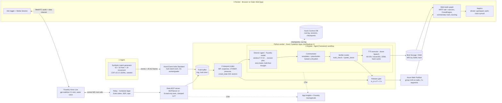

# 43 — Audio Stands: end-to-end implementation on the hackathon's hero stack

_Accessed/compiled: 20 Oct 2026 · Priority area: Audio Stands architecture (all five stages), build plan, judging_

## TL;DR

- **One delayed clock drives everything.** The generator writes to a truth buffer at truth time `t`. The listener hears playhead `P = t − D`, with **D = 10 s** ([39](39-anticipatory-emotional-commentary.md)). Only the Director and Commentator see the window `[P, P + D]`. Q&A tools, crowd outcome reactions and the browser only see `≤ P`, plus a 3 s audio prefetch that carries no outcome text. This "spoiler firewall" is the story we pitch, and we measure it with a spoiler-leak eval whose target is 0 ([42](42-audio-competitors-and-demo.md)).
- **Every box maps to a hero technology:**
  - Event Hubs → Python worker on Container Apps (Interpret, in code).
  - **Agent Framework** workflow: Director agent (Foundry model), then Commentator (templates + LLM polish), then a Verifier in code, then **Azure Speech** HD TTS, pre-synthesised.
  - Delivery: Blob/SWA audio + **Web PubSub** segments.
  - Browser: Web Audio for crowd, ball, earcons and haptics.
  - Q&A: **Foundry Voice Live** over WebRTC through a relay, calling our **Stats MCP server**.
  - State: **Cosmos DB**. Build-time: Copilot agent mode + Azure MCP Server ([46](46-copilot-github-azure-mcp-workflow.md)).
- **New facts from Microsoft Learn change the TTS plan:**
  - HD voices are **"Real-time only"**, so batch synthesis can't render them.
  - DragonHD has no `<prosody>` and no `express-as`, but does have `<break>` and `[style]` tags. DragonHD Omni has `express-as` but no `<break>`.
  - Free-tier TTS allows only **20 transactions per 60 s**. Pre-rendering ~950 lines therefore takes ~48 min on F0, against about 32 s at S0's 30 TPS.
  - Voice Live needs **S0** (F0 is "Not applicable"). Sessions are capped at **60 min** and **120,000 TPM**, and WebRTC still uses a `2026-01-01-preview` API version.
- **Cost is dominated by Q&A, not commentary.** Commentary is rendered once per match and profile: about **$1.46** for an English HD "Radio" track. Per listener we pay delivery (about 21.9 MB of MP3 and ~2,850 Web PubSub messages per match) plus about **$0.02 per question** ([40](40-conversational-commentator.md)).
- **Judge mode is a static bundle on SWA.** It holds the cues, ball ticks, MP3 lines, CC0 crowd clips and pre-rendered preset answers, and runs with zero backend. **Enter Best Use of Microsoft Foundry.** Build the replay bundle by the end of day 2, and the live path and Voice Live on days 3–4.

## Findings

### 1. Component diagram and product mapping



| Box | Product | Why this one |
|---|---|---|
| Generator | Python in an ACA job (live) or a local script (replay) | It is seeded and emits CDF that passes the validator ([26](26-cdf-spadl-data-tooling.md)). Apply the two bug fixes from [33](33-synthetic-possession-value.md) first, and use [19](19-realistic-player-movement.md) movement so `where_is` and distance answers sound real. |
| Transport | **Event Hubs Standard**, 1 TU | 1 TU = 1,000 events/s ingress. One match is ~1,091 actions ([33](33-synthetic-possession-value.md): 218,180 / 200) plus 25 frames/s. Standard is needed for 20 consumer groups (Basic has 1) ([01](01-azure-realtime-pipeline.md)). The local emulator lets us develop offline. |
| Interpret | Plain Python on **Container Apps** with `minReplicas: 1` | WP/suspense ([23](23-win-probability-and-momentum.md), [39](39-anticipatory-emotional-commentary.md)), `crowd_states` ([38](38-reactive-crowd-atmosphere.md)) and VAEP rating at <1 ms per action ([33](33-synthetic-possession-value.md)) are code. Scale-from-zero is the main latency risk ([01](01-azure-realtime-pipeline.md)). |
| Director, Commentator | **Microsoft Agent Framework** (`pip install agent-framework`, `FoundryChatClient`) with a Foundry model | Learn describes workflows for "well-defined steps" and agents for judgment. The Director makes the judgment calls: which beat to narrate, when to hold a question, the pundit slot. Everything else is code ([18](18-agentic-design-for-pipelines.md)). Cosmos checkpoints and OTel spans come with the framework. |
| TTS | **Azure Speech** real-time SDK; HD for EN, neural for BG | Learn quotes HD latency as "Less than 300 ms". HD is real-time only, so pre-render in an SDK loop and cache by SSML hash ([39](39-anticipatory-emotional-commentary.md)). |
| Audio delivery | **Blob Storage** (live) / **Static Web Apps** (replay) | Files are immutable and versioned by hash. SWA Free includes 100 GB/month of bandwidth with no overage ([21](21-demo-uptime-cost-and-ops.md)). |
| Cue delivery | **Web PubSub** | One group per (match, language, verbosity) ([01](01-azure-realtime-pipeline.md), [24](24-producer-console-control-path.md)). Each unit accepts at most 1,000 concurrent connections (Learn). |
| Browser | Web Audio, Vibration/Gamepad APIs | No Azure service is needed for the crowd, spatial audio or haptics ([37](37-spatial-audio-in-the-browser.md), [38](38-reactive-crowd-atmosphere.md), [41](41-haptics-match-tension.md)). Say this honestly: these are not agents ([42](42-audio-competitors-and-demo.md)). |
| Q&A | **Foundry Voice Live**, WebRTC | Function calling, semantic VAD, noise suppression, AEC and Azure voices. The answer voice can match the commentary voice ([40](40-conversational-commentator.md)). |
| Relay | Small Node or Python service on ACA | Learn says the control WebSocket that carries tool calls is "typically initiated by your server". The relay holds the Entra token, so no key ever reaches the page. |
| Tools | Our **Stats MCP server** (MCP SDK v2 `MCPServer`) | The same functions serve Voice Live (via REST), the Director (via MCP) and Copilot agent mode at build time ([46](46-copilot-github-azure-mcp-workflow.md)). |
| State | **Cosmos DB** free tier | Cue log, listener sessions (playhead, preferences), workflow checkpoints ([18](18-agentic-design-for-pipelines.md)). |
| Ops | App Insights, Foundry evaluations, **azd + Bicep**, GitHub Actions with OIDC | [21](21-demo-uptime-cost-and-ops.md), [30](30-infra-as-code-azd-bicep.md). **Azure MCP Server** is build-time only: Learn says the local server is "intended strictly for developer use". |

### 2. Timing model and spoiler firewall

```
truth time t  ───────────────────────────────────────────────▶  generator writes the truth buffer
                     ├──────────── D = 10 s ────────────┤
playhead P = t − D   ▲ the listener hears this           ▲ t (newest truth)
Director / Commentator window:   [P, P + D]  =  [t − D, t]
browser receives:                cues with tc_in ≤ P + 3 s   (audio prefetch; no aria text before tc_in)
Q&A tools, catch-up, crowd outcome reactions:   state at ≤ P
```

| Component | Sees | May output | Must never output |
|---|---|---|---|
| Interpret (code) | Truth up to `t` | Signals keyed by event time | n/a (server-only) |
| Director agent | `[P, P+D]` | `build_up_level`, `lead_s`, `hold_ms`, `hint_type` (danger, not result) | Outcome of a future event |
| Commentator | Present facts + tension plan; the outcome only *for a line timed at or after the event* | Lines with `tc_in` and `reveal` | Outcome words in any line with `tc_in` < event time |
| Crowd (`crowd_states`) | Look-ahead **xG only**, 8 s ([38](38-reactive-crowd-atmosphere.md)) | Anticipation swell, the same for goal and miss | Outcome-shaped reaction before `tc_in` |
| Q&A tools / relay | State at `P` ([40](40-conversational-commentator.md)) | Verified `say` + evidence ids | Anything after `P`. The exception is "hold that thought", which says *that* something is near, never *what* |
| Browser | Segments up to `P + 3 s` | Audio, haptics | n/a |

**Wall-clock budget for a build-up line.**
- The Director first learns of a shot at truth time `t_shot`. The listener's playhead is then at `t_shot − 10`.
- The build line plays at `t_shot − LEAD_S` = `t_shot − 4` ([39](39-anticipatory-emotional-commentary.md)).
- That leaves **10 − 4 = 6 s of wall time** for: ingest → plan → verify → TTS → Blob → Web PubSub → client fetch and decode.
- The goal call itself plays at `t_shot + 0.2`, so it has 10.2 s.

**Why the LLM stays off build and call lines.** LLM polish took 7–12 s in the DFL ticker ([22](22-explanation-generation-patterns.md)), which does not fit 6 s. Build and call lines are templated. LLM colour lines carry `stale_ms` and are dropped if late.

**Playhead during Q&A.** The playhead keeps running and the commentary queue pauses. When the answer ends, a templated catch-up line resumes the commentary ([40](40-conversational-commentator.md)). That keeps D fixed, so crowd and haptics never drift.

### 3. Data contracts

**Cue, extended for audio.** This builds on the shared contract and [04](04-overlay-output-formats.md): 25 fps timecode, plus the `speech` block from [27](27-voice-speech-and-audio.md). Coordinates are CDF metres, origin at the centre spot ([26](26-cdf-spadl-data-tooling.md), [37](37-spatial-audio-in-the-browser.md)). Server-side phrase helpers convert to the 0–105 frame used in [36](36-blind-fans-and-audio-description.md)/[39](39-anticipatory-emotional-commentary.md)/[40](40-conversational-commentator.md). The release gate strips `utterance.ssml` before a cue leaves the server.

```json
{
  "cue_id": "c_0412", "seq": 412, "match_id": "m_s42", "match_clock": "63:12",
  "tc_in": "01:03:12:05", "t_in": 3792.2, "ttl_ms": 4000, "priority": 2,
  "kind": "build", "reveal": "none", "layout": "audio", "anchor": null, "metric": "tension",
  "text": { "describer": "Reds, far side, final third... Kovač!", "radio": "Reds breaking... Kovač!",
            "calm": null, "bg": "Червените пробиват... Ковач!" },
  "utterance": {
    "lang": "en-US", "voice": "en-US-Andrew:DragonHDLatestNeural", "style": "urgent", "intensity": 0.72,
    "ssml": "<speak ...><voice name=\"en-US-Andrew:DragonHDLatestNeural\" parameters=\"temperature=0.6\">[urgent] Reds breaking... Kovač!</voice></speak>",
    "ssml_sha256": "3f2a…", "audio_url": "/replay/v1/m_s42/en/radio/3f2a….mp3",
    "duration_ms": 2100, "stale_ms": 1500, "word_timings_url": null
  },
  "crowd_state": { "H": { "excitement": 0.81, "valence": 0.30, "danger": 0.74 },
                   "A": { "excitement": 0.81, "valence": -0.30, "danger": -0.74 }, "one_shot": null },
  "haptic": { "tacton": "attack", "team": "home", "at_offset_ms": 0, "heartbeat_tension": 0.72 },
  "spatial": { "x": 25.9, "y": 17.2, "z": 0.0, "earcon": null },
  "evidence": ["ev_9812"], "truth_check": "pass", "spoiler_check": "pass",
  "source": { "generator_seed": 42, "planner": "lookahead_v1", "director": "dir_v1@gpt-5.4-mini", "xt": "xt_v3" }
}
```

**Segment (the live carrier, one Web PubSub message every 2 s).** It holds `{t0, t1, ball: [[x,y,z,speed]…] at 10 Hz, crowd: {H, A}, tension, cues: [...]}`. Billing counts Web PubSub messages in 2 KB units ([01](01-azure-realtime-pipeline.md)), so keep a segment at ≤ 2 KB:
- 20 ball samples × ~20 bytes ≈ 0.4 KB;
- the cues without SSML fill the rest.

The replay bundle stores ball positions at 25 Hz instead.

**Q&A tool schemas** (Voice Live `function` tools). Six are read-only lookups and come from [40](40-conversational-commentator.md); two personalisation tools come from [36](36-blind-fans-and-audio-description.md). The relay injects `session_id`, so the model never sets the clock.

```json
[
 {"type":"function","name":"get_score_and_clock","description":"Score and minute as the listener hears it now.","parameters":{"type":"object","properties":{},"additionalProperties":false}},
 {"type":"function","name":"get_ball_position","description":"Which team has the ball and where, in spoken zone words. Also pings the ball sound.","parameters":{"type":"object","properties":{},"additionalProperties":false}},
 {"type":"function","name":"where_is","description":"Where one player is now, relative to goal and ball.","parameters":{"type":"object","properties":{"player":{"type":"string","description":"Name or shirt number as the fan said it"}},"required":["player"],"additionalProperties":false}},
 {"type":"function","name":"get_player_stats","description":"Verified stats for one player so far.","parameters":{"type":"object","properties":{"player":{"type":"string"},"metrics":{"type":"array","items":{"type":"string","enum":["distance_km","top_speed_kmh","passes","shots"]}}},"required":["player"],"additionalProperties":false}},
 {"type":"function","name":"get_last_events","description":"Most recent events, newest first.","parameters":{"type":"object","properties":{"n":{"type":"integer","minimum":1,"maximum":5}},"additionalProperties":false}},
 {"type":"function","name":"explain_moment","description":"Why a recent moment mattered (cached, verified). Use an id from get_last_events.","parameters":{"type":"object","properties":{"moment_id":{"type":"string"}},"required":["moment_id"],"additionalProperties":false}},
 {"type":"function","name":"what_did_i_miss","description":"Key events since a match time.","parameters":{"type":"object","properties":{"since":{"type":"string","description":"mm:ss"}},"required":["since"],"additionalProperties":false}},
 {"type":"function","name":"set_preferences","description":"Change verbosity, crowd mix or vibration.","parameters":{"type":"object","properties":{"verbosity":{"type":"string","enum":["describer","radio","calm"]},"crowd_mix":{"type":"number","minimum":0,"maximum":1},"haptics":{"type":"string","enum":["off","events","full"]}},"additionalProperties":false}}
]
```

Every tool returns `{say, evidence_ids, as_of_clock}`, or `{error, candidates}` ([40](40-conversational-commentator.md)). `set_preferences` is answered by publishing a `pref` message to that listener's connection and does not touch the match state.

### 4. Latency budget

| Path step | Figure | Source |
|---|---|---|
| Generator → Event Hubs → worker | Measure. Keep the worker warm (KEDA polls every 30 s) | [01](01-azure-realtime-pipeline.md) |
| Interpret + rate an action | < 1 ms per action (0.11 s per match) | [33](33-synthetic-possession-value.md) |
| HD TTS | "Less than 300 ms" (first audio). Finish time grows with text length | Learn HD voices; [27](27-voice-speech-and-audio.md) |
| Batch synthesis (why we don't use it live) | p50 10–20 s, p95 120 s | Learn batch synthesis |
| Web PubSub fan-out | Unit-1 benchmark: 3,000 msg/s at p99 < 1 s | [01](01-azure-realtime-pipeline.md) |
| **Build line total** | Must fit in **6 s** (D − LEAD_S) | §2 |
| Q&A: end of speech → turn end | `silence_duration_ms` 500 ms default | [40](40-conversational-commentator.md) |
| Q&A: model first audio | Not published. Log `gen_ai.voice.first_token_latency_ms` | [27](27-voice-speech-and-audio.md) |
| Q&A benchmark to beat | Rival Matchday Companion median 4.66 s | [42](42-audio-competitors-and-demo.md) |
| Bluetooth output | +126–274 ms (AirPods, end to end) | [37](37-spatial-audio-in-the-browser.md) |
| Haptic vs audio sync window | Audio leads 26 ms … lags 51 ms. Fire the vibration early, never late | [41](41-haptics-match-tension.md) |

### 5. Cost budget (East US 2 list prices from [27](27-voice-speech-and-audio.md), [21](21-demo-uptime-cost-and-ops.md), [01](01-azure-realtime-pipeline.md); line counts are our estimates)

**Per match, once.** This cost does not grow with listeners.
- **Lines.** The planner guarantees a state line at least every 20 s, plus event lines. Assume one line every ~6 s: 95 min × 60 / 6 ≈ **950 lines**, each ~70 characters ([27](27-voice-speech-and-audio.md)'s typical line).
- **HD English "Radio" track:** 950 × 70 = 66,500 characters × $22 / 1M = **$1.46**.
- **Bulgarian neural:** 66,500 × $15 / 1M = $1.00. Describer (~1.5×) and Calm (~0.3×) add roughly 1.8 × $1.46 ≈ $2.63 for English.
- **Render time:**
  - On F0, 20 transactions per 60 s → 950 / 20 = **47.5 min**.
  - On S0, 30 TPS → 950 / 30 ≈ **32 s**, if requests run in parallel.
  - Live, the match needs only 950 / 95 ≈ 10 lines/min, but goal bursts and re-renders make F0 fragile. Plan for S0.
  - Whether HD voices are available on F0 at all is unverified.
- **Director and polish LLM:**
  - File [21](21-demo-uptime-cost-and-ops.md) estimates ~$0.10 per match on `gpt-5.4-mini`.
  - Our cap is one Director call per 10 s, so ≤ 570 calls per match. At the 10K TPM deployment ceiling ([30](30-infra-as-code-azd-bicep.md)), 6 calls/min leaves ≤ 1,666 tokens per call, so keep the prompt plus output ≤ 1,200.
  - Output cost: 570 × 200 tokens × $4.50 / 1M ≈ $0.51. The input price is not in our files (unverified).

**Per listener, per 95-minute match.**
- **Commentary MP3:** about 950 lines × 3.85 s (10 words at 2.6 words/s, [39](39-anticipatory-emotional-commentary.md)) ≈ 3,650 s of speech. At 48 kbit/s that is 6 KB/s, so **≈ 21.9 MB**. SWA's 100 GB/month covers ≈ 4,500 listener-matches.
- **Web PubSub:** 5,700 s / 2 s = **2,850 messages**.
  - Free_F1 (20,000/day) covers 7 listener-matches per day.
  - Standard ($1.61/day, 1M/day) covers ≈ 350.
- **Voice Live:**
  - About $0.02 per question ([40](40-conversational-commentator.md)). 10 questions cost $0.20; the 30-question cap is $0.60.
  - Capacity per resource: each question uses ≈ 30 input + 200 output audio tokens + ~3K context tokens ≈ 3,230 tokens. 120,000 TPM / 3,230 ≈ **37 questions per minute**, and there is also a limit of 100 new connections per minute.
  - Whether a gated, silent mic track is billed as input audio is unverified. Connect lazily on the first Ask and close after 90 s idle.
- **Infra for 3 weeks of judging:** ≈ $25–34 minimal stack ([21](21-demo-uptime-cost-and-ops.md)). Add $15.12 for Event Hubs and $33.81 for Web PubSub Standard only if the live path stays on.

### 6. Replay / judge mode (zero backend)

The landing page uses `ReplaySource`. It is the same client code as `LiveSource`, but it reads `/replay/v1/<match>/`:
- `manifest.json`: D, kits, seat, chapters, hashes;
- `cues.<lang>.<verbosity>.jsonl`;
- `ticks.json.gz`: ball at 25 Hz, crowd state H/A at 1 Hz;
- `audio/<lang>/<verbosity>/*.mp3`;
- `crowd/*.mp3`: CC0 clips ([38](38-reactive-crowd-atmosphere.md)). Use MP3 or M4A, not OGG, for Safari (unverified);
- `earcons/*`;
- `captions_sdh.vtt` + `descriptions.vtt` ([32](32-accessible-responsive-viewer.md), [42](42-audio-competitors-and-demo.md));
- `answers/`.

**Ask works offline as well.** Preset questions run local TypeScript versions of the tools on the local playhead. They play pre-rendered fragments:
- 2 teams × 3 sides × 3 thirds = **18 zone clips** ("Reds have it, far side, final third");
- **21 distance clips** (0–100 m in 5 m steps);
- **one score/clock clip per minute** (95);
- the catch-up lines already in the cues.

That is about 134 short clips, under $0.25 of HD TTS. The "Talk live" button opens Voice Live and falls back to the presets on any error.

**Ship a ~8-minute "judge cut" seed as well as the full match.** It should contain at least one goal, a save, a card and a VAR-style hush, with "next big moment" chapter keys. A judge-cut track is ~300 s of speech × 6 KB/s ≈ 1.8 MB of audio. The whole bundle sits well under SWA Free's 250 MB per environment ([21](21-demo-uptime-cost-and-ops.md)).

### 7. Risks and mitigations

| Risk | Mitigation |
|---|---|
| **iOS cannot vibrate from the web.** Firefox Android returns `true` but does nothing ([41](41-haptics-match-tension.md)) | Use Android Chrome + gamepad rumble. Add a "did you feel it?" test button, an on-screen pulse in the video, an honest iPhone line, and the AHAP file as a roadmap item. |
| **Bluetooth latency** of 126–274 ms ([37](37-spatial-audio-in-the-browser.md)) | Schedule everything on the `AudioContext` clock. Fire each vibration at `audibleAt − 20 ms` using `outputLatency` ([41](41-haptics-match-tension.md)). Add a one-tap calibration. We have no video to sync, so only haptics care. |
| **Voice Live WebRTC is preview** (`2026-01-01-preview`), with a 60-min session cap and **S0 only** (Learn) | Run a lazy session per Ask burst and reconnect at 55 min ([40](40-conversational-commentator.md)). Fall back to the relay over WebSocket (GA, `2026-04-10` per [27](27-voice-speech-and-audio.md)), then to preset answers. |
| **Quota.** TTS F0 allows 20 transactions/60 s and is not adjustable. Voice Live allows 100 connections/min and 120K TPM. Foundry deployment is 10K TPM | Pre-render on S0 with 429 retry and backoff (Learn). Cap Director calls. Set `DEMO_MODE` and per-IP limits ([21](21-demo-uptime-cost-and-ops.md)). Replay needs no quota at all. |
| **HD SSML limits.** DragonHD: no `prosody`, `express-as`, `audio`, `bookmark` or `mstts:silence`. Omni: no `break` or `prosody`. Only en-US DragonHD personas are listed. Each output varies slightly | Put intensity into `[style]` tags, wording, `<break>` (DragonHD only) and the crowd bed. Lower `temperature`. **Never re-synthesise a cached hash**, so the replay sounds identical. Use Borislav neural with prosody for BG ([39](39-anticipatory-emotional-commentary.md)). Drop the `en-GB-…:DragonHD` names from [27](27-voice-speech-and-audio.md)/[40](40-conversational-commentator.md). |
| **Screen reader ducks our audio** (TalkBack) | In audio mode, mute the per-cue live regions and keep only state changes ([40](40-conversational-commentator.md)). |
| **Echo:** crowd from the speakers leaks into the mic | Gate the mic, duck the crowd to about 15%, use AEC, and recommend headphones while keeping laptop speakers usable ([40](40-conversational-commentator.md), [42](42-audio-competitors-and-demo.md)). |
| **Spoiler through the cue stream** | Release gate at `P + 3 s`, a `reveal` field, and the spoiler-leak eval in CI (code below). |
| **Legal** | CC0 crowd clips only, synthetic chants, AI voice labelled, no real clubs or commentators ([27](27-voice-speech-and-audio.md), [38](38-reactive-crowd-atmosphere.md)). |
| **No blind-user testing in time** | Use the honest wording from [36](36-blind-fans-and-audio-description.md). Run an eyes-closed comprehension test with ≥ 3 people and say what it is. |

## So what for us

**Audio Stands, all five stages:**

| Stage | What runs there |
|---|---|
| Ingest | Generator → Event Hubs |
| Interpret | Worker signals |
| Explain | Director, Commentator and Verifier in Agent Framework |
| Render | TTS, then Web Audio, spatial sound and haptics in the browser |
| Personalise | Club end, verbosity, language, mix and Ask |

Build the replay path first. Everything live is the same code fed by a different `MatchSource`.

**Build order: 2 people, Tue 21 → Mon 27 Oct.** P1 = Python, AI and Azure. P2 = TypeScript, audio and UX. Each day ends with something we can demo.

| Day | P1 | P2 | Demo-able at end of day |
|---|---|---|---|
| 1 · Tue 21 | Generator with the 33 fixes and 19 movement. Truth buffer. WP, suspense and tension; `crowd_states`. Write `cues.jsonl` + ticks for seed 42 | Accessible shell: Start button unlocks audio. `AudioStands` spatial module + `CrowdEngine` with ~15 CC0 clips. Plays local ticks | Eyes closed: the crowd swells and the ball rattles across the stereo field for a seeded match |
| 2 · Wed 22 | Planner ([39](39-anticipatory-emotional-commentary.md)) + SSML builders + pre-synth cache → MP3s. Verifier: numbers + spoiler-leak | Commentary track scheduled on the audio clock, ducking, `haptics.ts`, `ReplaySource` + manifest | **MVP: full judge-cut replay.** Build-up before chances, calls, crowd, haptics, zero backend. Deploy to SWA |
| 3 · Thu 23 | Stats MCP server + REST routes clamped to P. Preset-answer fragments | Voice Live relay + browser WebRTC + Ask state machine + catch-up | "Where's the ball?" mid-attack, answered in the commentator's voice with a ball ping |
| 4 · Fri 24 | Live path: Event Hubs → ACA worker → Agent Framework Director/Commentator (LLM polish with stale drop, greedy fallback) → Web PubSub segments. OTel | `LiveSource`, clock sync ([24](24-producer-console-control-path.md)), "hold that thought", settings (seat, verbosity, mix, club end) | "Run live": a fresh seed end to end on Azure at D = 10 s |
| 5 · Sat 25 | Evals: spoiler-leak = 0, numeric truth, Q&A p50/p95, Foundry evaluators. `azd` judge env, availability test, limits | SDH captions from cues, Playwright + axe, tests on Android Chrome and iOS Safari, eyes-closed listening test | A green eval table and a trace screenshot. Phone-tested |
| 6 · Sun 26 | README mapped to the 5 criteria, architecture diagram, "How we built it" ([46](46-copilot-github-azure-mcp-workflow.md)) | Video under 2:00: works muted, captions, radar, one listener's reaction ([42](42-audio-competitors-and-demo.md)) | Submission draft complete |
| 7 · Mon 27 | Freeze `judge`, submit by midday PT (deadline 23:59 PT, [12](12-judging-criteria-and-rules.md)) | Buffer | Submitted |

**Cut list if we fall behind, cutting first from the top:**
1. Bulgarian.
2. Phone-pointer mode.
3. Gamepad rumble.
4. Describer/Calm tracks: ship Radio only.
5. LLM colour polish: templates only.
6. Event Hubs in the live path: run the generator in-process.
7. Live Voice Live: keep preset Ask only. This is a big loss.

**Never cut** the replay bundle, the look-ahead build-up, the crowd, or the spoiler-leak number.

**Team account steps (we did none of them).** Each must be done by a team member. See 44 when it lands.
- Azure subscription with a budget alert.
- Foundry resource (`AIServices`) in East US 2 or Sweden Central, which have Voice Live global deployments ([27](27-voice-speech-and-audio.md)), on **S0**.
- A `gpt-5.4-mini` deployment with 10K TPM, `NoAutoUpgrade`.
- Web PubSub (Free, then Standard ≥ 2 days before the demo).
- SWA, Cosmos free tier, App Insights.
- A public GitHub repo with OIDC.
- A YouTube upload.
- Check each person's Copilot plan ([46](46-copilot-github-azure-mcp-workflow.md)).

**Prize category: Best Use of Microsoft Foundry** ([42](42-audio-competitors-and-demo.md)). Foundry covers Voice Live, the Foundry model behind the Agent Framework Director, evaluations and tracing. Name the category in the first line of the write-up. File [12](12-judging-criteria-and-rules.md)'s Cloud Native suggestion was made for TwinCast.

**Pitch (3 sentences):**
> Audio Stands puts a blind or low-vision fan in the stands. A spatial crowd tuned to their club, a ball they can hear move and a heartbeat in their hand all rise with the match, and a commentator's voice builds *before* the big chance, because our Foundry Director agent hears the next ten seconds that the fan hasn't yet. A spoiler firewall keeps that look-ahead honest: it is measured at zero leaks, every spoken number is verified against the synthetic ground truth, and the fan can ask the same voice "where's the ball?" at any moment through Foundry Voice Live and our Stats MCP server. It runs on Event Hubs, Container Apps, Agent Framework, Azure Speech, Web PubSub and Cosmos DB, and judges can open a zero-backend replay right now.

**Other ideas, briefly:**
- **17 Heartbeat** and **20 Home End** are absorbed into Audio Stands.
- **D Chalk Talk** reuses the relay with a `draw_on_frame` tool.
- **C One Number** can use tension as its one number.
- **21 Called It** reuses suspense as its "big moment" flag.
- **A TwinCast** can take this audio layer as a soundtrack. The `MatchSource` and segment contract carry over unchanged.

## Reuse: code & links

**One clock, the firewall, and the spoiler-leak eval** (Python, ours, untested):

```python
D_S, PREFETCH_S = 10.0, 3.0
OUTCOME = {"goal", "scores", "scored", "saved", "save", "wide", "miss", "missed", "blocked", "post"}

class Clock:
    def __init__(self, t0_wall: float): self.t0 = t0_wall          # wall time of truth t = 0
    def truth(self, now: float) -> float: return now - self.t0
    def playhead(self, now: float) -> float: return self.truth(now) - D_S

def director_window(events, clk, now):                               # Director / Commentator only
    p = clk.playhead(now); return [e for e in events if p <= e["t"] <= p + D_S]

def qa_view(events, clk, now):                                       # tools, catch-up, crowd reactions
    p = clk.playhead(now); return [e for e in events if e["t"] <= p]

def release(cues, clk, now, sent: set):                              # what may leave the server
    p = clk.playhead(now); out = []
    for c in cues:
        if c["t_in"] <= p + PREFETCH_S and c["cue_id"] not in sent:
            c = {**c, "utterance": {k: v for k, v in c["utterance"].items() if k != "ssml"}}
            out.append(c); sent.add(c["cue_id"])
    return out

def spoiler_leaks(cues, events):
    """Lines that air before a shot's outcome, within D, and use an outcome word. CI target: [] (review hits by hand)."""
    shots = [e for e in events if e["type"] == "shot"]
    hits = []
    for c in cues:
        words = set(c["text"]["radio"].lower().replace("!", " ").replace(".", " ").split())
        for e in shots:
            if 0 < e["t"] - c["t_in"] <= D_S and words & OUTCOME:
                hits.append((c["cue_id"], e["id"]))
    return hits
# also report "spoiler lift" (file 39): P(goal | build line fired) vs mean pre-shot xG of those chances
```

**Same client, two sources** (TypeScript, ours, untested). This hooks into `AudioStands` ([37](37-spatial-audio-in-the-browser.md)), `CrowdEngine` ([38](38-reactive-crowd-atmosphere.md)) and `Haptics` ([41](41-haptics-match-tension.md)).

```ts
export interface Segment { t0: number; t1: number; ball: [number, number, number, number][];
  crowd: { H: CrowdState; A: CrowdState }; tension: number; cues: Cue[] }
export interface MatchSource { start(onSeg: (s: Segment) => void): Promise<void>; playheadS(): number }

export class ReplaySource implements MatchSource {           // judge mode: static files only
  private t0Ctx = 0; private segs: Segment[] = [];
  constructor(private ctx: AudioContext, private base: string) {}
  async start(onSeg: (s: Segment) => void) {
    this.segs = await (await fetch(`${this.base}/segments.json`)).json();   // pre-chunked 2 s segments
    this.t0Ctx = this.ctx.currentTime + 0.5; let i = 0;
    const pump = () => {                                      // feed 3 s ahead, like the live release gate
      while (i < this.segs.length && this.segs[i].t0 <= this.playheadS() + 3) onSeg(this.segs[i++]);
      if (i < this.segs.length) setTimeout(pump, 250);
    };
    pump();
  }
  playheadS() { return this.ctx.currentTime - this.t0Ctx; }
}

export function wire(ctx: AudioContext, src: MatchSource, stands: AudioStands, crowd: CrowdEngine,
                     hap: Haptics, club: "H" | "A", play: (url: string, at: number) => void) {
  const toCtx = (t: number) => t - src.playheadS() + ctx.currentTime;   // match time -> audio clock
  return src.start((s) => {
    crowd.setState(s.crowd[club]); hap.setTension(s.tension);
    s.ball.forEach(([x, y, z, v], k) => setTimeout(() => stands.onFrame({ x, y, z, speed: v, alive: true }),
      Math.max(0, (toCtx(s.t0 + k * 0.1) - ctx.currentTime) * 1000)));
    for (const c of s.cues) {
      const at = toCtx(c.t_in);
      if (c.utterance?.audio_url) play(c.utterance.audio_url, at);    // ducking happens inside play()
      if (c.crowd_state?.one_shot) crowd.trigger(c.crowd_state.one_shot, at);
      if (c.haptic) hap.event(c.haptic.tacton, c.haptic.team, at);
      if (c.spatial?.earcon) stands.earcon(c.spatial.earcon, c.spatial.x, c.spatial.y, 1, at);
    }
  });
}
```

**Replay manifest:**

```json
{"bundle":"v1","match_id":"m_s42","seed":42,"generator":"gen02+fix33+mov19","delay_s":10,
 "duration_s":480,"cut":"judge","kits":{"H":"red, white shorts","A":"navy, sky-blue sleeves"},
 "chapters":[{"t":61,"label":"first big chance"},{"t":212,"label":"goal"}],
 "tracks":{"en":{"radio":"cues.en.radio.jsonl"},"bg":{"radio":"cues.bg.radio.jsonl"}},
 "ticks":"ticks.json.gz","answers":"answers/index.json","captions":"captions_sdh.vtt",
 "ai_voice_notice":"Commentary uses Azure AI voices. Match data is synthetic.","sha256":{"cues.en.radio.jsonl":"…"}}
```

**Links:**
- Voice Live samples: https://github.com/microsoft-foundry/voicelive-samples
- Batch synthesis samples (neural voices only, not HD): https://github.com/Azure-Samples/cognitive-services-speech-sdk/tree/master/samples/batch-synthesis
- Agent Framework: https://github.com/microsoft/agent-framework
- Internal code to lift as-is:
  - planner, SSML and pre-synth: [39](39-anticipatory-emotional-commentary.md)
  - tools, relay and Ask: [40](40-conversational-commentator.md)
  - `haptics.ts`: [41](41-haptics-match-tension.md)
  - `audio-stands.ts`: [37](37-spatial-audio-in-the-browser.md)
  - `crowd_states` and `CrowdEngine`: [38](38-reactive-crowd-atmosphere.md)
  - Bicep: [30](30-infra-as-code-azd-bicep.md)

## Sources

- Voice Live API with WebRTC (three channels, event routing, preview API version) — https://learn.microsoft.com/en-us/azure/ai-services/speech-service/voice-live-webrtc — accessed 20 Oct 2026
- Voice Live API overview (models per tier, pricing tiers, ~10/~20 audio tokens per second) — https://learn.microsoft.com/en-us/azure/ai-services/speech-service/voice-live — accessed 20 Oct 2026
- Quotas and limits for Azure Speech (Voice Live S0 limits, TTS F0 20 transactions/60 s, S0 30 TPS, batch synthesis limits) — https://learn.microsoft.com/en-us/azure/ai-services/speech-service/speech-services-quotas-and-limits — accessed 20 Oct 2026
- What are neural text to speech HD voices? (real-time only, < 300 ms, SSML support table, styles, temperature) — https://learn.microsoft.com/en-us/azure/ai-services/speech-service/high-definition-voices — accessed 20 Oct 2026
- Batch synthesis API for text to speech (latency p50/p95, word boundary files) — https://learn.microsoft.com/en-us/azure/ai-services/speech-service/batch-synthesis — accessed 20 Oct 2026
- Microsoft Agent Framework overview (agents vs workflows, Foundry client) — https://learn.microsoft.com/en-us/agent-framework/overview/ — accessed 20 Oct 2026
- What is the Azure MCP Server? (developer use only, Copilot agent mode) — https://learn.microsoft.com/en-us/azure/developer/azure-mcp-server/overview — accessed 20 Oct 2026
- Create an Azure Web PubSub resource (1,000 concurrent connections per unit, Free_F1/Standard_S1) — https://learn.microsoft.com/en-us/azure/azure-web-pubsub/howto-develop-create-instance — accessed 20 Oct 2026
- Internal research files (prices, limits and measurements are cited from these):
  - [01](01-azure-realtime-pipeline.md), [04](04-overlay-output-formats.md), [12](12-judging-criteria-and-rules.md), [18](18-agentic-design-for-pipelines.md), [19](19-realistic-player-movement.md)
  - [21](21-demo-uptime-cost-and-ops.md), [22](22-explanation-generation-patterns.md), [23](23-win-probability-and-momentum.md), [24](24-producer-console-control-path.md), [26](26-cdf-spadl-data-tooling.md)
  - [27](27-voice-speech-and-audio.md), [30](30-infra-as-code-azd-bicep.md), [32](32-accessible-responsive-viewer.md), [33](33-synthetic-possession-value.md), [36](36-blind-fans-and-audio-description.md)
  - [37](37-spatial-audio-in-the-browser.md), [38](38-reactive-crowd-atmosphere.md), [39](39-anticipatory-emotional-commentary.md), [40](40-conversational-commentator.md), [41](41-haptics-match-tension.md)
  - [42](42-audio-competitors-and-demo.md), [46](46-copilot-github-azure-mcp-workflow.md)
